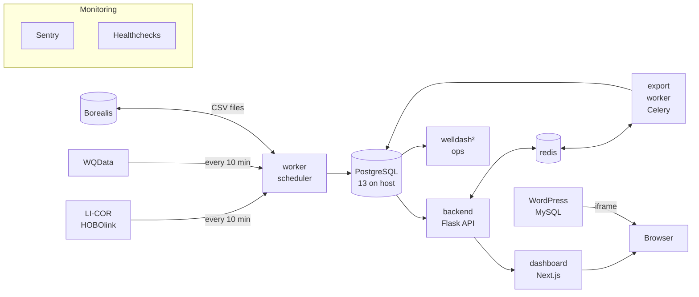

# WELL Environmental Data Platform

Part of the McMaster Watershed Ecosystems Living Lab (WELL). This platform fetches, stores and visualizes environmental
sensor data from weather and water quality stations, and serves near real-time insights through an interactive web
dashboard.

It runs two sites:

1. **[welldash.mcmaster.ca](https://welldash.mcmaster.ca)**, the WELL Environmental Sensor Dashboard: a Next.js
   dashboard with a Flask backend, also embedded in the WordPress site through an iframe.
2. **[well.mcmaster.ca](https://well.mcmaster.ca)**, the WELL home page: WordPress with a custom PHP theme, a banner
   carousel and links to the dashboard.

Both run in Docker Compose on one Linux VM: WordPress on port 8080, the dashboard on port 8081. Both hostnames point at
McMaster's reverse proxy, which terminates TLS and forwards to the VM; its configuration isn't in this repository.
`nginx.conf` and the commented-out `proxy` service in `docker-compose.yml` are for local development only.

## Architecture



<!-- GitHub draws every node 120 px wide and may cut off a line wider than that, so keep each line of a label to about 10 characters, break lines with <br/>, keep edge labels to a few words, and put the details in the list below. -->

1. **Ingestion.** The `worker` container runs one scheduler loop: every 10 minutes it fetches new readings from LI-COR
   (the weather station and water-level loggers) and WQData (the water quality sonde), stores them and checks for
   alerts. It also moves CSV files to and from Borealis (a monthly upload of the sensor data, a weekly download of
   creek sampling results), copies the monthly file to SharePoint when that is configured, backs up the database
   nightly and sends a daily digest.
2. **Storage.** PostgreSQL 13 runs on the VM itself, not in Docker; the containers reach it on the host's IP.
3. **API.** The `backend` container is a Flask app on gunicorn with no public port. Chart data is aggregated in SQL
   for each request.
4. **Dashboard.** The `dashboard` container is Next.js. The browser fetches all data from the dashboard's own API
   routes, which pass each request on to Flask; the browser never talks to Flask directly.
5. **Downloads.** Small CSV exports are built while the visitor waits; larger ones are queued in Redis and built by
   the `export_worker` container (Celery).
6. **Monitoring.** Errors go to Sentry and job heartbeats to Healthchecks.io; the worker also emails alerts, and
   `/health/data` reports how fresh the data is.
7. **WordPress.** The `wordpress` container (its data in MySQL, the `db` container) serves the home page, which shows
   the dashboard in an iframe.
8. **welldash².** The `ops` container is a private, read-only operations dashboard, reachable only on McMaster's
   network.

## Quick start (development)

```bash
# Backend: Python 3.11, as in its image
cd dashboard/backend
python -m venv venv && source venv/bin/activate     # Windows: .\venv\Scripts\activate
pip install -r requirements.txt
python -m unittest discover -s tests -t .           # the tests; no database or network needed for most
cd app && python server.py                          # the API on http://localhost:5000 (needs DATABASE_URL)

# Dashboard: Node, in another terminal
cd dashboard/frontend
npm ci
FLASK_API_URL=http://localhost:5000 npm run dev     # http://localhost:3000
```

The settings each part reads, and the env files they go in, are in [docs/configuration.md](docs/configuration.md).
The whole stack runs with `docker compose up -d --build` once the root `.env`, `dashboard/backend/app/.env` and
`dashboard/frontend/.env.local` exist.

## Deploying

The VM runs `main`. `./deploy.sh` on the VM pulls `main`, rebuilds only the services whose files changed, checks the
dashboard, its data API and WordPress, and rolls back to the previous commit if a check fails. From cron,
`./deploy.sh --auto` deploys a new commit only once CI has passed, and holds changes that need a person (a database
migration, `docker-compose.yml`, a WordPress core update). Details, and the checks to make before adding the cron line,
are in [docs/deploying.md](docs/deploying.md).

## Where to find things

| Topic | Where |
|---|---|
| API endpoints, ingestion and scheduler jobs, exports, Borealis and SharePoint, monitoring and alerts, error reporting, backups, migrations, backend tests, the disabled AI analysis | [dashboard/backend/README.md](dashboard/backend/README.md) |
| The dashboard: charts, map, visitor counts (GoatCounter), dashboard tests, end-to-end tests | [dashboard/frontend/README.md](dashboard/frontend/README.md) |
| welldash², the operations dashboard | [dashboard/backend/app/ops/README.md](dashboard/backend/app/ops/README.md) |
| CI, the API canary, Sentry errors as GitHub issues, the daily maintainer, the load test, Dependabot | [.github/workflows/README.md](.github/workflows/README.md) |
| The WordPress site | [wordpress/README.md](wordpress/README.md) |
| Every environment variable | [docs/configuration.md](docs/configuration.md) |
| The VM, Docker services, host firewall | [docs/hosting.md](docs/hosting.md) |
| Deploying with `deploy.sh` | [docs/deploying.md](docs/deploying.md) |
| The sampling CSV format | [docs/sampling-csv-format.md](docs/sampling-csv-format.md) |
| Uploading sampling files to Borealis | [dashboard/backend/app/scripts/README.md](dashboard/backend/app/scripts/README.md) |
| The public file formats (golden files) | [dashboard/backend/tests/golden/README.md](dashboard/backend/tests/golden/README.md) |
| Load testing | [docs/load-testing.md](docs/load-testing.md) |
| Terms of use and privacy | [docs/terms-and-privacy.md](docs/terms-and-privacy.md) |

## Tech stack

| Layer | Technologies |
|---|---|
| Frontend | Next.js 16, React 19, TypeScript, Tailwind CSS, Highcharts, MapLibre GL |
| Backend | Python 3.11, Flask, Gunicorn (WSGI), SQLAlchemy |
| Jobs and queue | `schedule` loop in the worker; Celery with Redis for large exports |
| Database | PostgreSQL 13 (VM host); MySQL 5.7 for WordPress |
| Infrastructure | Docker Compose on a Linux VM, behind McMaster's reverse proxy |
| CMS | WordPress (PHP, Bootstrap, Flickity) |
| External services | LI-COR (HOBOlink), WQData Live, Borealis; SharePoint (off until configured); OpenAI (AI analysis, disabled) |
| Monitoring | Sentry, Healthchecks.io, email digest and alerts, daily API canary (GitHub Actions) |
| Deploy and CI | `deploy.sh` (by hand or from cron), GitHub Actions |
