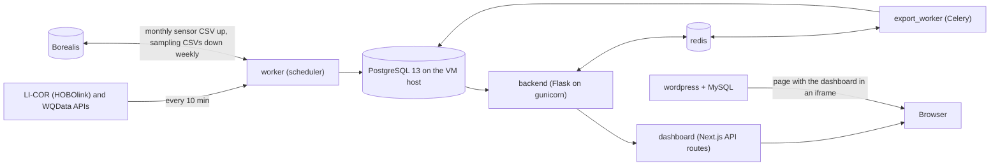

# WELL Environmental Data Platform

Part of the McMaster Watershed Ecosystems Living Lab (WELL). This platform fetches, stores, and visualizes environmental sensor data from weather and water quality stations, serving near real-time insights through an interactive web dashboard.

**Live:** [welldash.mcmaster.ca](https://welldash.mcmaster.ca) | **WordPress Home:** [well.mcmaster.ca](https://well.mcmaster.ca)

---

## Overview

The platform consists of two main components:

1. **WELL Environmental Sensor Dashboard** — A standalone Next.js dashboard with a Flask backend, hosted at `welldash.mcmaster.ca` and embedded into the WordPress site via iframe.
2. **WELL WordPress Home Page** — A custom PHP WordPress theme at `well.mcmaster.ca` with a banner carousel, responsive imagery, and links to the dashboard.

Both run in Docker on one Linux VM (`docker-compose.yml`): WordPress on port 8080 and the dashboard on port 8081. Neither container serves HTTPS: both hostnames point at McMaster's reverse proxy (`haproxy.cas.mcmaster.ca`), which terminates TLS and forwards to the VM. That proxy's configuration isn't in this repository. `nginx.conf` and the commented-out `proxy` service in `docker-compose.yml` are for local development only.

---

## Architecture



How data flows:
1. **Ingestion.** The `worker` container runs `scripts/scheduler_temp.py`: one Python `schedule` loop that starts each job in its own thread, and never starts a job again while its last run is still going. Every 10 minutes it fetches new readings from LI-COR (the weather station and the water-level loggers) and WQData (the water quality sonde), writes them to PostgreSQL, then runs the alert check. It also runs the weekly Borealis sampling download, the monthly Borealis upload (followed by the SharePoint copy, once that is configured) and the daily digest; see [Off-VM copies](#off-vm-copies-borealis-and-sharepoint) and [Monitoring](#monitoring).
2. **Storage.** PostgreSQL 13 runs on the VM itself, not in Docker; the containers reach it on the host's IP (see the firewall note below). Readings are in `sensor_measurements`, one row per reading with a unique index on (station, measurement, time); creek sampling results are in `sampling_measurements`.
3. **API.** The `backend` container is a Flask app on gunicorn with no public port. Chart data is aggregated in SQL for each request; nothing is precomputed.
4. **Dashboard.** The `dashboard` container is Next.js. The browser loads the page, then fetches all data from the dashboard's own API routes (`dashboard/frontend/src/pages/api/`), which pass each request on to Flask (`src/lib/proxyBackend.ts`). The browser never talks to Flask directly.
5. **Downloads.** A CSV export of up to `EXPORT_SYNC_ROW_THRESHOLD` readings is built while the visitor waits. A larger one is queued in Redis and built by the `export_worker` container (Celery), whose built-in beat scheduler deletes expired files every hour.
6. **Monitoring.** Errors go to Sentry, job heartbeats to Healthchecks.io, the worker emails a daily digest and alerts, and `/health/data` reports how fresh the data is. See [Error reporting](#error-reporting-sentry) and [Monitoring](#monitoring).

Every setting is listed in [docs/configuration.md](docs/configuration.md).

### Frontend (Dashboard)
- **Next.js** 16 (pages router) with **TypeScript**, **React** 19 and **Tailwind CSS**, built as a standalone Node server (`dashboard/frontend/Dockerfile`)
- **Highcharts** for the time-series charts and the wind rose; the station map is **MapLibre GL** with OpenFreeMap tiles (`src/components/map/Map.tsx`)
- No server-side data fetching: custom React hooks (`src/hooks/`) load the data in the browser, through the API routes above

### Backend
- **Flask** WSGI app served by **Gunicorn** (3 processes with 4 threads each, `dashboard/backend/Dockerfile`)
- Routes (`dashboard/backend/app/api/routes/`). The browser reaches each through the dashboard's API route of the same path, except where noted:
  - `/api/series`: the sensor charts (below)
  - `/api/data`: raw readings for a range, used for the wind rose; capped by `DATA_MAX_ROWS` (413 beyond it)
  - `/api/latest`: the newest reading of every series (the Latest Data panel)
  - `/api/samples` and `/api/recent`: creek sampling results, and the newest of each measurement; `/api/samples/template.csv` (the dashboard's `/api/sampling-template`) is the sampling CSV template
  - `/api/exports/estimate`, `/api/exports/sync`, `/api/exports/jobs`, `/api/exports/jobs/<id>` and `/api/exports/jobs/<id>/download`: CSV downloads
  - `/health` (the process is up; not passed through) and `/health/data` (data freshness, see Monitoring; the dashboard's `/api/health/data`)
- `/api/series?start=&end=&group_type=...` serves chart data aggregated in PostgreSQL: about 2,000 points per series
  (raw 10-minute readings up to ~2 weeks, coarser buckets beyond; ranges longer than ~5.5 years are capped at daily
  buckets, so they get more). Times with an offset (`...Z`) are real instants, times without one are Toronto local
  time. Each series has an `agg` field saying what its `avg` array holds: `mean` for most measurements, `sum` for
  Rain (the bucket total; `min`/`max` stay the smallest and largest single reading), and `vector_mean` for Wind
  Direction (350° and 10° average to 0°; `min`/`max` are null, since a linear min/max of angles means nothing).
  Details in `dashboard/backend/app/api/routes/series.py`.
- Under load: a statement timeout on every API query (`DB_STATEMENT_TIMEOUT_MS`, a 504 past it), a short Redis cache of `/api/series` answers, and `Cache-Control` headers on `/api/latest` and `/api/series` (see "How the API stays responsive under load" below). There is no ETag and no proxy cache.
- Flask accepts requests from any origin (`CORS(app)` in `server.py`); what keeps it private is that it has no public port, so only the dashboard container reaches it.

### Storage
- **PostgreSQL** 13 on the VM host: sensor readings, sampling results, export jobs, alert state, and the record of applied migrations (`dashboard/backend/app/db/models.py`)
- Schema changes are numbered SQL migrations, applied by hand (see [Database migrations](#database-migrations))
- Worker logs and the records of uploaded months are files in `dashboard/backend/app/logs/`, mounted from the host
- Export CSVs stay in the `exports_data` Docker volume for `EXPORT_FILE_TTL_MINUTES`
- WordPress keeps its own data in MySQL 5.7 (the `db` container, `db_data` volume)
- Nightly `pg_dump` backups of the database on the VM, 7 daily + 8 weekly kept ([Database backups](#database-backups))

### WordPress Home Page
- Custom PHP template under `wp-content/themes/well`
- **Bootstrap** grid and utility classes for responsive layout
- **Flickity** banner carousel with adaptive height
- Responsive images via `srcset/sizes`; accessible alt text throughout
- Links to a dedicated page that embeds the dashboard via iframe

### Hosting & Infrastructure
- Seven Docker Compose services: `db` (MySQL), `wordpress` (the stock image with `home/` mounted), `backend`, `redis`, `worker`, `export_worker` and `dashboard` (`backend`, `worker` and `export_worker` are built from one image)
- TLS and the public hostnames are handled by McMaster's reverse proxy, outside this repository
- No Content-Security-Policy, `frame-ancestors` or `X-Frame-Options` header is set, by this repository or (as of November 2026) on the live sites, so any site can frame the dashboard
- Secrets are injected through env files that aren't committed (see [docs/configuration.md](docs/configuration.md))
- The VM runs `main`, deployed by `deploy.sh` (see [Deploying](#deploying))

**Host firewall (required).** PostgreSQL runs on the VM itself, not in Docker, and the containers connect to it on the host's IP, port 5432. The host's iptables service loads `/etc/sysconfig/iptables` at boot, and that file must contain this line above its final `-A INPUT -j REJECT` line:

```
-A INPUT -s 10.20.0.0/16 -p tcp -m tcp --dport 5432 -m comment --comment "WELL dashboard: Docker containers to host PostgreSQL (required)" -j ACCEPT
```

Without it, every container fails with "No route to host" after the next reboot, and ingestion stops. To add it without a reboot as well, run `sudo iptables -I INPUT -s 10.20.0.0/16 -p tcp --dport 5432 -j ACCEPT`. Never run `systemctl restart iptables`, which wipes Docker's own rules until Docker restarts. Never run `iptables-save > /etc/sysconfig/iptables` either, which would save Docker's temporary rules into the file.

Of the Docker networks in `10.20.0.0/16`, `10.20.2.0/24` is `wp_probe`, used only by welldash²'s check of WordPress (see [welldash²](#welldash²-operations-dashboard)). Nothing on it needs PostgreSQL, so a narrower rule should leave it out: welldash² reaches PostgreSQL from `internal_api`, which carries its default route.

---

## Data Sources & APIs

| Source | Type |
|---|---|
| HoboLink (Licor Cloud API) | Automated ingestion & scheduled updates |
| WQData Live API | Automated ingestion & scheduled updates |
| Borealis | Monthly sensor CSV upload; weekly sampling download ([Off-VM copies](#off-vm-copies-borealis-and-sharepoint)) |
| SharePoint | Monthly sensor CSV upload, when configured ([Off-VM copies](#off-vm-copies-borealis-and-sharepoint)) |

### API canary

`.github/workflows/canary.yml` runs `dashboard/backend/app/scripts/api_canary.py` every day at 11:17 UTC. It makes one small request to each source and checks both the HTTP status and that the response still has the fields ingestion reads:

- **LI-COR**: the last 6 hours for the first logger in `HOBOLINK_LOGGERS` (`data[]` records with `sensor_sn`, and a `timestamp` and numeric `value` on every record ingestion stores; battery and unknown logger channels are skipped, as ingestion skips them).
- **WQData**: the last 6 hours for `WQ_DEVICE_ID`, as exactly one request, because WQData's hourly quota is shared with the 10-minute ingestion (`data[]` points with `timestamp` and `values[].parameterId`, plus `info` for paging).
- **Borealis**: the metadata of both datasets (`BOREALIS_SAMPLING_PERSISTENT_ID`, which downloads read, and `BOREALIS_UPLOAD_PERSISTENT_ID`, which uploads add to; the older `DEMO_BOREALIS_*` names are read when these are unset) with `BOREALIS_API_TOKEN` (`data.latestVersion` with `versionState` and `files[].dataFile`). This proves the token is accepted and can read both datasets, not that it may still add files: the monthly upload also needs edit rights on the upload dataset, which the canary doesn't test (`scripts/borealis_check.py --check` does).

It prints one `OK` or `FAIL` line per source (HTTP status and reason only, never URLs, keys or response bodies) and fails the run if any source fails. An empty response counts as a failure too, since ingestion would have nothing to store. Every failure shows on the repository's Actions tab, and the workflow keeps one GitHub issue in step with it (`.github/scripts/canary_issue.sh`, run by the workflow's second job):

- **A failed run** opens an issue titled "API canary failing", labelled `canary` (the label is created if missing) and assigned to `lukhsaankumar`, with the run's `OK`/`FAIL` lines and a link to the run. If a `canary` issue is already open, the run adds the same as a comment instead, so a long outage stays in one issue. A run that fails before the canary prints anything (a failed install, a timeout) still counts as a failure, and says so. The issue also says "printed no results" if GitHub withheld the lines: it drops a job output that contains any secret's value (the run log then shows "Skip output 'report' since it may contain secret"), which can happen if a short secret such as `WQ_DEVICE_ID` matches a printed number. The run log still has the lines.
- **The next passing run** comments "Recovered" with its link and closes the issue. A passing run with no open issue does nothing.
- Only the canary's own `OK`/`FAIL` lines are posted. The issue job uses the workflow's `GITHUB_TOKEN` with `issues: write` (and `contents: read`), runs on a separate runner from the vendor secrets, and only runs for scheduled and manual runs, never for pull requests.

Being assigned (or watching the repository) means GitHub emails about the issue. The usual "workflow run failed" email also still goes out, if the person's notification settings include Actions: for a scheduled run, to whoever last changed the workflow's `cron` line (or last re-enabled the workflow); for a manual run, to whoever started it. GitHub turns scheduled workflows off after 60 days without activity in the repository, and a disabled schedule sends nothing and opens no issue: after a quiet period, check the Actions tab and re-enable the workflow there.

Using it:

- **Run it by hand**: Actions → API canary → Run workflow. On the VM, once the image includes the script: `docker compose exec worker python scripts/api_canary.py`.
- **When a key is rotated**, update the matching repository secret (Settings → Secrets and variables → Actions) as well as `dashboard/backend/app/.env` on the VM, then run the canary by hand. The secrets are `HOBOLINK_API_URL`, `HOBOLINK_API_TOKEN`, `HOBOLINK_LOGGERS`, `WQ_API_URL`, `WQ_API_KEY`, `WQ_DEVICE_ID`, `BOREALIS_URL`, `BOREALIS_API_TOKEN`, `BOREALIS_SAMPLING_PERSISTENT_ID` and `BOREALIS_UPLOAD_PERSISTENT_ID` (or the older `DEMO_BOREALIS_URL`, `DEMO_BOREALIS_AW_PERSISTENT_ID` and `DEMO_BOREALIS_WC_PERSISTENT_ID`). The Borealis token and the WQData key are both due for rotation.
- **Tests**: `dashboard/backend/tests/test_api_canary.py` (no network). The canary keeps copies of a few constants from `utils/parsers.py` so the workflow needs only `requests`; CI runs the tests that check those copies still match on every pull request, with the rest of the backend tests (by hand, from `dashboard/backend`: `python -m unittest discover -s tests -t .`). The issue logic is tested by `.github/scripts/test_canary_issue.sh` against a stub `gh` (`bash .github/scripts/test_canary_issue.sh`; CI runs it with the deploy script test).

## Database backups

The PostgreSQL database (on the VM host, outside Docker) is the only complete copy of the data, and some of it can't be fetched again: LI-COR serves at most one year of history. So the worker backs it up every night.

- **When**: 03:15 Toronto time, every night (`scripts/backup_db.py`, run by the scheduler; its output goes to `logs/backup.log`). It pings `HEALTHCHECK_URL_BACKUP` when it starts and again when it ends (`/fail` if it failed), and a failure is reported to Sentry.
- **What**: `pg_dump -Fc` (PostgreSQL's compressed custom format) of every table the role in `DATABASE_URL` can read (on the VM that is `postgres`, so the whole database), made with `pg_dump` 13, the server's version (the backend image installs `postgresql-client-13` from the PostgreSQL apt repository). The password reaches `pg_dump` through a temporary 0600 password file, never its command line.
- **Where**: `~/WELLWebsite/backups/welldb-YYYYmmdd-HHMM.dump` on the VM (`/app/backups` in the worker; the folder is gitignored). The files are readable by root only (the container runs as root, and the job sets `umask 077`), so use `sudo` on the host.
- **Checked**: each dump is written as a hidden `.partial` file, then read back with `pg_restore --list` (it must list data for `sensor_measurements` and `sampling_measurements`, `BACKUP_EXPECT_TABLES`) and in full, and only then renamed. A failed run leaves no file that looks like a backup, and the next run deletes an unfinished one left by a run that was killed. Each step has its own time limit (dump 80 min, checks 10 and 15 min), within the scheduler's 2 h for the whole run. Only one backup runs at a time (a lock file, `.backup.lock`). If deleting old dumps fails after a good backup, the run still counts as a success and logs a `WARNING:` line, which also goes to Sentry as a warning.
- **Retention**: the newest dump of each of the last 7 days (`BACKUP_KEEP_DAILY`) and of each of the last 8 ISO weeks (`BACKUP_KEEP_WEEKLY`), so at most 15 files. Only files named `welldb-YYYYmmdd-HHMM.dump` are ever deleted, and only after a new dump has passed its check; a dump you copy in under another name (e.g. `manual-before-migration.dump`) stays. The job refuses to start if a dump the size of the last one would leave less than `BACKUP_MIN_FREE_MB` (default 2048) free, since the database shares the disk.

**Tables the role can't read are left out, and named.** `pg_dump` locks and reads every table it dumps, so by default (`BACKUP_EXCLUDE_TABLES` unset or `auto`) the job leaves out any table or sequence the connecting role can't read, and prints a `WARNING:` line naming them (in `logs/backup.log`, and sent to Sentry as a warning); the backup still counts as a success. On the VM the app connects as `postgres`, which reads everything, so nothing is left out. With a more limited role, tables created by migrations or by hand as `postgres` (`schema_migrations`, `vendor_status`, `alert_incidents`, `export_jobs`, `data_fixes`, `request_metrics`, `uptime_probes`) would be named. Grant that role `SELECT` on them (and on any sequence they own), or dump them now and then as `postgres` on the host, e.g. `sudo -u postgres pg_dump -Fc -t export_jobs -t data_fixes -f /tmp/well-postgres-tables.dump <database>`. Setting `BACKUP_EXCLUDE_TABLES` to a comma-separated list leaves out exactly those, with no warning; an empty value leaves out nothing, and the dump then fails if anything is unreadable.

**Run a backup by hand** (e.g. before a migration): `docker compose exec worker python scripts/backup_db.py --no-prune`. `--prune-only` applies retention without dumping.

**Restore drill** (optional; once a month is plenty): `docker compose exec worker python scripts/restore_check.py` restores the newest dump (or `--file /app/backups/<name>`) into a throwaway database, `welldb_restore_check` (another name given with `--database` must start with that, since the drill drops it first), compares each table's row count with the live database (read-only), and drops it again. Counts that grew since the dump are expected; a table missing from the restore or restored empty fails the drill, unless it was left out on purpose (`BACKUP_EXCLUDE_TABLES`) or because the role can't read it. Creating a database needs the `CREATEDB` privilege, which `postgres` (the app's role on the VM) has; for another role, grant it once (as `postgres`: `ALTER ROLE <app role> CREATEDB;`), or set `RESTORE_CHECK_DATABASE_URL` to a URL for a role that has it, which then creates, restores into and drops the throwaway database. Without either, the drill stops with a message saying so. A restore takes about as much disk as the live database, so the drill first checks that the backup folder's disk (the database's, on the VM) has that plus `BACKUP_MIN_FREE_MB` free; `--no-space-check` skips this when the database is on another disk.

**Restoring for real.** Restore into a new, empty database, put back anything the dump left out, then point the app at it. `<app role>` is the role in `BACKEND_DATABASE_URL` (`postgres` on the VM).

```bash
cd ~/WELLWebsite
docker compose stop worker export_worker      # nothing writes while you switch over
sudo -u postgres createdb -O <app role> welldb_restored
sudo cat backups/welldb-YYYYmmdd-HHMM.dump | sudo -u postgres pg_restore --no-owner --role=<app role> --exit-on-error -d welldb_restored
```

The next steps matter only if that night's `logs/backup.log` has a `WARNING:` line saying tables were left out. On the VM the app connects as `postgres`, so normally nothing was. If `data_fixes` was left out and you kept a dump of it made as `postgres` (see above), restore that: `sudo cat /path/to/well-postgres-tables.dump | sudo -u postgres pg_restore --exit-on-error -d welldb_restored`. If not, recreate it with a row for each dated fix that had run, so none can run a second time; without its row, running `2026-11-10_swap_air_soil_temperature.sql` again would swap air and soil temperature back. Each fix's name is in the `INSERT INTO data_fixes` line of its file in `dashboard/backend/app/db/migrations/`; so far that is only the 2026-11-10 one. These statements are safe to run even if the table came back with the dump:

```bash
sudo -u postgres psql -d welldb_restored -v ON_ERROR_STOP=1 \
  -c "CREATE TABLE IF NOT EXISTS data_fixes (name text PRIMARY KEY, applied_at timestamptz NOT NULL DEFAULT now())" \
  -c "INSERT INTO data_fixes (name) VALUES ('2026-11-10 swap air and soil temperature') ON CONFLICT (name) DO NOTHING"
```

Then switch over:

```bash
# In ~/WELLWebsite/.env, change the database name in BACKEND_DATABASE_URL to welldb_restored. Then create any of the
# app's tables still missing (e.g. export_jobs, if it was left out): db/init_db.py runs create_all(), which creates
# missing tables only and never changes existing ones, so it is harmless when nothing is missing.
docker compose run --rm --no-deps backend python db/init_db.py
# Recreate the containers so they read the new URL. Until then the backend keeps serving the old database.
docker compose up -d backend worker export_worker
```

The next ingestion runs continue from the newest reading in the restored database, within their look-back limit; fill a longer gap with `scripts/licor_backfill.py` and `scripts/wqdata_backfill.py` (LI-COR only as far back as its one-year limit).

**Off-VM copies.** These dumps sit on the VM's own disk, so they protect against mistakes (a bad migration or fix, deleted rows), not against losing the VM. The monthly CSVs on Borealis and SharePoint ([Off-VM copies](#off-vm-copies-borealis-and-sharepoint)) hold the sensor readings off the VM. Borealis is public, so dumps never go there; once SharePoint access exists, copying a weekly dump to that private library is the next step. Until then, copy one off by hand now and then, e.g. `ssh well 'sudo cat ~/WELLWebsite/backups/<name>.dump' > <name>.dump`, and keep it somewhere private.

## Off-VM copies: Borealis and SharePoint

The database lives on one VM, so each month's sensor data is also copied off it, twice:

- **Borealis** (`borealisdata.ca`, the Scholars Portal Dataverse that McMaster uses). This is the public, citable copy. On the 1st of each month at 02:00 Toronto time the worker runs `scripts/upload_data.py`. It exports the month that just ended as `WELLWestCampus_<Mon><YYYY>.csv` (the dashboard's CSV layout), adds it to the upload dataset in a folder for the year, and publishes a new major version of the dataset.
- **SharePoint**, a McMaster document library. Right after Borealis, `scripts/sharepoint_upload.py` uploads the same file to `<SHAREPOINT_FOLDER>/<year>/` through Microsoft Graph. The two copies are kept apart: each has its own record of uploaded months (`logs/uploaded_months.json` and `logs/sharepoint_uploaded_months.json`) and its own heartbeat (`HEALTHCHECK_URL_UPLOAD` and `HEALTHCHECK_URL_SHAREPOINT`). If one of them fails, it is retried every day at 02:00 and the other isn't held up.

Borealis also carries data the other way. Creek **sampling** results are uploaded by people to a second dataset, and the weekly download (`scripts/download_data.py`, Sundays 00:00 by the container clock, UTC) checks each new file against [the sampling CSV format](docs/sampling-csv-format.md) and imports it into the Ancaster Watershed tab.

### How the Borealis jobs behave

- **Publishing.** Adding a file only changes the dataset's *draft*, which only its editors can see, so the upload publishes the draft afterwards. It publishes only a draft that holds this month's file unpublished (added or replaced by this run, or left by a run that failed before publishing); a draft with only someone else's changes, such as a curator's metadata edit, is left for them to publish. Dataverse has only one draft per dataset, though, so **a draft that is open when the month's file is added (a curator's unfinished edit) is published together with that file**, and the log warns when that happens. Curators should finish or discard edits on the upload dataset before the 1st of the month (the upload runs at 02:00 Toronto time, and retries daily until it succeeds), or set `BOREALIS_PUBLISH=0` while they work. Any version that changes files has to be published as a **major** version (Dataverse refuses a minor one), so the dataset goes 1.0, 2.0, and so on, one version per month. The first publish also needs the dataset's collection to be published. Set `BOREALIS_PUBLISH=0` to leave each month as a draft for a curator to publish instead.
- **No tabular ingest.** Uploads are sent with `tabIngest=false`. That stores the CSV byte for byte, so its checksum matches the one the job computes, and no ingest lock delays publishing. (Ingest would turn it into a `.tab` file, and the CSV's blank separator columns and repeated headers don't convert well.)
- **Safe to re-run.** If a file with the same name and checksum is already in the dataset, nothing is sent, and if that file is still waiting in a draft, the draft is published. A changed file *replaces* the published one, and Dataverse keeps the old copy in the earlier version. A changed file that was never published is deleted and added again, because Dataverse can't replace an unpublished file. So a run that failed between upload and publish is finished by the next run, without a duplicate file.
- **Errors** name the cause without printing the token or URLs (the token is also scrubbed from anything Borealis says back, which can repeat it). 401 means the token is wrong or expired, 403 means the account lacks a role (Curator is needed), 404 means a wrong id or the demo server, and 409 means the dataset is locked or the collection isn't published. Each month's CSV is now built in seconds: the old version filtered the whole month once per cell and logged every cell, which took about 45 minutes and wrote about 110 MB to `logs/db_uploads.log` per run.
- **The download reads only the published version.** A file someone uploaded but nobody has published yet is skipped, and the log says that a draft is waiting. It is imported on the first run after the dataset is published. Restricted files are skipped, so the download needs no token: a published sampling dataset works without one.

### Settings (`dashboard/backend/app/.env`, read by the worker)

| Variable | What |
|---|---|
| `BOREALIS_URL` | `https://borealisdata.ca`. A collection page such as `https://borealisdata.ca/dataverse/WELL` also works: the jobs use only its server part, and the preflight checks the collection `WELL`. |
| `BOREALIS_API_TOKEN` | The API token of the account that uploads and publishes (it needs the Curator role on the upload dataset or its collection). |
| `BOREALIS_UPLOAD_PERSISTENT_ID` | The sensor dataset, e.g. `doi:10.5683/SP3/ABCDEF` (dataset page > Metadata > Persistent Identifier). |
| `BOREALIS_SAMPLING_PERSISTENT_ID` | The sampling dataset. |
| `BOREALIS_UPLOAD_DATAVERSE`, `BOREALIS_SAMPLING_DATAVERSE` | The aliases of the two collections. Only the preflight uses them. |
| `BOREALIS_PUBLISH` | `1` (default) publishes each month; `0` leaves a draft. |
| `BOREALIS_UPLOAD_FIRST_MONTH` | The first month uploaded (default `2026-10`). |
| `SHAREPOINT_TENANT_ID`, `SHAREPOINT_CLIENT_ID`, `SHAREPOINT_CLIENT_SECRET` | The Entra ID app that IT registers (see below). |
| `SHAREPOINT_SITE` | e.g. `https://mcmaster.sharepoint.com/sites/WELL`. |
| `SHAREPOINT_LIBRARY`, `SHAREPOINT_FOLDER` | The document library (default `Documents`) and the folder in it (default `WELL sensor data`). |
| `SHAREPOINT_UPLOAD_FIRST_MONTH` | The first month copied to SharePoint (default: the Borealis one). |
| `HEALTHCHECK_URL_SHAREPOINT` | Heartbeat for the SharePoint copy (see Monitoring). |

The SharePoint copy is **off** while none of the first four `SHAREPOINT_*` variables is set. If only some are set, the worker logs which ones are missing and reports a failure at 02:00. The older `DEMO_BOREALIS_URL`, `DEMO_BOREALIS_WC_PERSISTENT_ID` (upload) and `DEMO_BOREALIS_AW_PERSISTENT_ID` (sampling) are still read when the new names are unset. They point at `demo.borealisdata.ca`, a test server that is reset from time to time and is not a backup, and the upload refuses to mix a production URL with a demo dataset id.

### Checking it

```sh
docker compose exec worker python scripts/borealis_check.py --check      # read-only: GET requests only
docker compose exec worker python scripts/sharepoint_upload.py --check   # read-only: sign-in, site, library, folder
docker compose exec worker python scripts/upload_data.py --year 2026 --month 10 --dry-run   # build the CSV only
```

`borealis_check.py` checks the settings, whether the token is valid and when it expires, whether each collection is published and what your account may do in it, and each dataset's published version, licence, locks and permissions (`canEditDataset` and `canPublishDataset` on the upload dataset). For the sampling dataset it also checks that it is published and holds the template and a README. It ends with a numbered list of what is still missing, and exits 1 until that list is empty. It never prints the token.

### Setting it up: what to obtain, in order

**Borealis**

1. **Ask for a role on the WELL collection.** The collection exists and is published: [borealisdata.ca/dataverse/WELL](https://borealisdata.ca/dataverse/WELL), inside the McMaster University collection. Email McMaster Library's Research Data Management team at **rdm@mcmaster.ca**, who administer the McMaster collection on Borealis (Scholars Portal runs the service and is reached through them). Ask for the **Curator** role on `WELL` (or **Admin**, if you will also manage other people's access) for the account that will own the token. Use a shared lab account if possible, so the token doesn't depend on one person. Curator can create collections and datasets and add and publish files.
2. **Create the API token.** Log in to borealisdata.ca as that account, then go to your name (top right) > **API Token** > **Create Token** (or **Recreate Token**). Tokens expire, usually after a year: note the date, which `borealis_check.py` prints. The old token was issued on the demo server and has returned 401 since 2026-08-30.
3. **Create two sub-collections** in `WELL` (Add Data > New Dataverse), for example "WELL West Campus sensor data" (alias `WELL-sensors`) and "WELL Ancaster Creek sampling" (alias `WELL-sampling`). Give each a contact email and a category such as Laboratory or Research Project. **Publish both**, since datasets can't be published before their collection.
4. **Create one dataset in each** (Add Data > New Dataset). The citation metadata required to publish is the title, author (WELL / McMaster University), point-of-contact email, description and subject (Earth and Environmental Sciences). Keywords, geographic coverage (Hamilton, Ontario, Canada) and time period are recommended. **Licence:** choose one under Terms. **CC BY 4.0** is suggested (attribution required); CC0 1.0 is the Dataverse default if the lab prefers no conditions. Use the same licence for both datasets.
5. **Sampling dataset:** before publishing it, upload
   - the template, `dashboard/backend/app/sampling_template.csv`, under the name **`WELLAncasterWatershed_SAMPLE.csv`**. The import ignores that name.
   - a **README** (e.g. `README.md`) that tells uploaders to follow the format in `docs/sampling-csv-format.md` (or link to it on GitHub), to name files `WELLAncasterWatershed_<description>.csv`, to check them with `scripts/check_sampling_csv.py`, and to **publish the dataset after adding files** (otherwise they aren't imported).

   Then **publish** the dataset. Give the people who upload sampling files the **Contributor** role on it (they can add files; a Curator publishes) or Curator (they publish themselves).
6. **Sensor dataset:** it can stay empty. The first monthly upload publishes version 1.0. Copy both persistent ids (`doi:10.5683/...`).
7. **On the VM**, set `BOREALIS_URL`, `BOREALIS_API_TOKEN`, `BOREALIS_UPLOAD_PERSISTENT_ID`, `BOREALIS_SAMPLING_PERSISTENT_ID`, `BOREALIS_UPLOAD_DATAVERSE` and `BOREALIS_SAMPLING_DATAVERSE` in `dashboard/backend/app/.env`, then remove the `DEMO_BOREALIS_*` lines. Next, recreate the worker so it reads them: `docker compose up -d --no-deps worker`. Run `borealis_check.py --check` until it says Ready. Then upload October by hand, `docker compose exec worker python scripts/upload_data.py --year 2026 --month 10`, or wait for 02:00. Also update the canary's repository secrets: `BOREALIS_URL`, `BOREALIS_API_TOKEN`, `BOREALIS_UPLOAD_PERSISTENT_ID` and `BOREALIS_SAMPLING_PERSISTENT_ID`. The canary reads those names first; delete the `DEMO_BOREALIS_*` secrets afterwards.

**SharePoint**

8. **Choose the destination:** a SharePoint site the lab owns (or ask IT to create one, e.g. "WELL"), its document library (usually *Documents*), and a folder (default `WELL sensor data`; the job creates it and one subfolder per year).
9. **Ask McMaster IT** (UTS service desk) for an app registration. The text below is ready to send, with the site URL filled in.
10. **On the VM**, set `SHAREPOINT_TENANT_ID`, `SHAREPOINT_CLIENT_ID`, `SHAREPOINT_CLIENT_SECRET`, `SHAREPOINT_SITE` (and `SHAREPOINT_LIBRARY` / `SHAREPOINT_FOLDER` if they differ from the defaults) in `dashboard/backend/app/.env`. Add a Healthchecks.io check, "WELL SharePoint copy" (cron `0 2 1 * *`, America/Toronto, grace 4 h), and set its ping URL as `HEALTHCHECK_URL_SHAREPOINT`. Then recreate the worker. Run `sharepoint_upload.py --check`, then `sharepoint_upload.py --year 2026 --month 10` once by hand to prove write access. Put a reminder in the calendar for the client secret's expiry date.

Request for McMaster IT:

```text
Subject: Entra ID app registration with Microsoft Graph Sites.Selected (write) for one SharePoint site

Hello,

The Watershed Ecosystems Living Lab (WELL) dashboard (https://welldash.mcmaster.ca) runs on a McMaster VM
and needs to copy one CSV file of sensor data per month into a SharePoint document library, unattended,
as an off-server backup. We would like to use an app-only identity limited to that one site:

1. An app registration in the McMaster Entra ID tenant, e.g. named "WELL dashboard SharePoint upload",
   single tenant, no redirect URI.
2. Microsoft Graph APPLICATION permission "Sites.Selected", with admin consent granted.
   (Not Sites.ReadWrite.All: we only need the one site below.)
3. A site-specific grant for that app with the "write" role on this site:
     Site: https://mcmaster.sharepoint.com/sites/<SITE>
   e.g. with Graph: POST https://graph.microsoft.com/v1.0/sites/{site-id}/permissions
     {"roles": ["write"],
      "grantedToIdentities": [{"application": {"id": "<app client id>", "displayName": "WELL dashboard SharePoint upload"}}]}
   or with PnP PowerShell: Grant-PnPAzureADAppSitePermission -AppId <app client id>
     -DisplayName "WELL dashboard SharePoint upload" -Site https://mcmaster.sharepoint.com/sites/<SITE> -Permissions Write
4. A client secret for the app (please tell us its expiry date).

Please send us the tenant ID, the application (client) ID and the secret (through a secure channel).
The app signs in with the OAuth 2.0 client-credentials flow and only creates and replaces files
in the folder "WELL sensor data" of the site's Documents library. It never signs in as a user.

Contact: <name>, <email>, WELL / <department>

Thank you!
```

---

## Automation

The scheduled jobs run inside the containers, not from cron. The `worker` container runs `scripts/scheduler_temp.py`, one Python `schedule` loop that starts each job in its own thread:
- **Ingestion** every 10 minutes: new LI-COR and WQData readings, then the alert check (see [Monitoring](#monitoring)). It also runs once when the worker starts, to catch up after a restart.
- **Sampling download** every Sunday at 00:00 by the container's clock (UTC unless `TZ` is set): new sampling CSVs from Borealis (see [Off-VM copies](#off-vm-copies-borealis-and-sharepoint)).
- **Monthly upload** at 02:00 Toronto time: each month that has ended and isn't uploaded yet goes to Borealis (so last month goes up on the 1st, and a failed month is retried the next day), then the same file to SharePoint, which stays off until its settings are filled in.
- **Daily digest** at `DIGEST_HOUR` (default 07:00 Toronto time).
- **Database backup** at 03:15 Toronto time: a checked `pg_dump` of the database, 7 daily and 8 weekly dumps kept (see [Database backups](#database-backups)).

The `export_worker` container (Celery with its beat scheduler) deletes expired download files every hour. Backfills of missed vendor data aren't scheduled: run `scripts/licor_backfill.py` or `scripts/wqdata_backfill.py` by hand (their headers explain how). The only cron job is the optional `deploy.sh --auto` line below.

### Deploying

The VM runs `main`. On the VM, `./deploy.sh`:
- pulls `main`;
- rebuilds only the services whose files changed:
  - `dashboard/frontend/` → `dashboard`;
  - `dashboard/backend/` → `backend`, `worker`, `export_worker`, and `ops` (welldash²) when it is running. A minute later `ops` is checked like the workers, but a failing `ops` is only logged ("welldash² needs a look"): it isn't public, so it never rolls the site back;
  - `docker-compose.yml` → everything;
  - `wordpress/*.conf` or `*.ini` (Apache/PHP settings mounted into the `wordpress` container) → the `wordpress` container is recreated, since Apache and PHP read them only at start;
  - `home/` needs nothing: the `wordpress` service is the stock `wordpress` image with `home/` bind-mounted, so it's live once pulled.
- checks the site: `/api/latest`, the dashboard home page (both on port 8081) and the WordPress home page (port 8080). If `worker` or `export_worker` was rebuilt, it also checks a minute later that the container is still running and hasn't restarted (compose restarts crashing workers, so "running" alone proves nothing);
- rolls back to the previous commit if any check fails.

If the site is already unhealthy before a deploy, `--auto` doesn't deploy (so the new commit isn't blamed and rolled back); `./deploy.sh` by hand deploys anyway and doesn't roll back.

Each run is logged in `deploy.log` (best effort: a log it can't write never stops a deploy halfway), and any failure, expected or not, logs a `FAILED:` line. Over 5 MB, `deploy.log` is moved to `deploy.log.1` and a new one started. `./deploy.sh --dry-run` only shows what would happen: no log, no pings, no state. It refuses to run over local edits to tracked files, so change the VM only through `main`.

`./deploy.sh --auto` deploys a new commit on `main` only once the CI jobs listed in `REQUIRED_CHECKS` at the top of `deploy.sh` have passed (`.github/workflows/ci.yml`): "Backend image and tests", "Dashboard build", "Dashboard image", "Deploy script" and "End-to-end data (vendors to browser)". The "Lint Python, shell and compose" job isn't waited for, so a lint failure alone doesn't stop a deploy. A job that is renamed in `ci.yml` but not in `REQUIRED_CHECKS` counts as still running, so nothing deploys until both match. It holds changes that need a person, logging them and leaving them for you:
- a new database migration;
- `docker-compose.yml`;
- a WordPress core update, which needs its database update run from wp-admin.

Deploy those with `./deploy.sh`. `--auto` reports each problem once, not every 5 minutes: a held commit, failed CI, local edits, a non-fast-forward or a merge git refuses, a GitHub API error or unreadable reply, a fetch error, an already-unhealthy site, or any other command failing (keyed by its line). A commit that was deployed and rolled back isn't retried, whatever else fails in between; a newer commit on `main`, or `./deploy.sh` by hand, moves past it.

#### Before adding the cron line

Check these on the VM first; each is something `--auto` relies on:
- The tracked tree is clean (`git status --porcelain --untracked-files=no` prints nothing) and `find home ! -user elankuml | head` prints nothing, so a pull can update every file.
- The three health checks return 200 now:
  ```
  curl -s -o /dev/null -w '%{http_code}\n' http://127.0.0.1:8081/api/latest
  curl -s -o /dev/null -w '%{http_code}\n' http://127.0.0.1:8081/
  curl -s -o /dev/null -w '%{http_code}\n' -H 'Host: well.mcmaster.ca' -H 'X-Forwarded-Proto: https' http://127.0.0.1:8080/
  ```
- `DASHBOARD_PORT` in `.env` is 8081 (the checks use that port).
- Fetching works without an SSH agent, as it will from cron: `env -i HOME=$HOME PATH=/usr/bin:/bin git fetch origin main`.
- Run `./deploy.sh` once by hand.

Then add this to your crontab (`crontab -e`):

```
*/5 * * * * cd ~/WELLWebsite && DEPLOY_HEALTHCHECK_URL=https://hc-ping.com/<uuid> ./deploy.sh --auto >/dev/null 2>>deploy.log
```

`DEPLOY_HEALTHCHECK_URL` is optional. The script pings it on success (up to date, or deployed and healthy) and pings `<url>/fail` on a failure or a held commit. Runs that are waiting (CI still running, a problem already reported, another deploy in progress) don't ping. So set the Healthchecks period to 5 minutes and the grace time longer than CI takes (30 minutes is safe), or a slow CI run will look like an outage.

### Error reporting (Sentry)

Unexpected errors are reported to Sentry (organization `well-cs`, free tier), from the Flask API, the worker
scheduler, the Celery export worker and the dashboard (browser and Next.js server). Each backend event is tagged
`component` (`backend`, `worker` or `export_worker`); scheduler errors also carry `job` (e.g. `api_injection_job`)
and, for a vendor ingestion failure, `source` (`LI-COR` or `WQData`).

- **Sent:** the error type, message and stack trace (file and line, no local variables), the endpoint's method and
  path, the environment, and recent breadcrumbs (log lines, page changes and outgoing requests, with their query
  strings replaced by `[Filtered]`). For a failed scheduler subprocess, also its command, exit code and the last
  2,000 characters of its stderr (a traceback when the script crashed) and the `ERROR:` and `[ERROR]` lines it
  printed to stdout (its handled failures, e.g. "No sensor data found"; the rest of stdout is not sent).
- **Not sent:** request bodies, cookies, headers, query strings, IP addresses or any user identity
  (`send_default_pii` off, plus a `before_send` filter in `dashboard/backend/app/utils/sentry.py` and
  `dashboard/frontend/src/lib/sentry.ts`). No performance tracing and no session replay, so nothing counts against
  the free tier's transaction or replay quotas. Source maps are not uploaded, so dashboard stack traces show the
  minified code.

How backend failures are reported:
- The scheduler runs the Borealis download, the monthly upload and the daily digest as subprocesses with
  `SENTRY_DSN` emptied, so those scripts never report themselves. When one fails or times out, the scheduler sends
  a single event for it. Most of those scripts catch their errors and exit non-zero, so a script reporting
  itself would miss them, and a crash would be sent twice (the script's traceback plus the scheduler's
  `CalledProcessError`).
- A caught failure (a job, or one vendor's ingestion) is sent at most once an hour for the same job, vendor, error
  type and message (its first line with numbers collapsed, HTTP statuses kept; for a failed subprocess, its arguments
  such as the month, its exit code, and its last stderr line or, with no stderr, its last `ERROR:` or `[ERROR]`
  stdout line).
  So an outage that fails every 10-minute run sends about 24 events a day per vendor instead of 144, while a
  different error is still sent at once. This limit covers only these scheduler failures; Flask and Celery errors
  are sent each time.
- A script run by hand (`docker compose exec worker python scripts/...`) reports its own uncaught errors, tagged
  with the container's `SENTRY_COMPONENT`.

Settings:
- Backend, in `dashboard/backend/app/.env` (read by `backend`, `worker` and `export_worker`): `SENTRY_DSN` (unset or
  empty turns reporting off; tests and local runs leave it unset, and the test suite removes it), `SENTRY_ENVIRONMENT`
  (default `production`) and, optionally, `GIT_SHA` as the release. `SENTRY_COMPONENT` (the `component` tag, default
  `backend`) is set in `docker-compose.yml` for `worker` and `export_worker`.
- Dashboard: `NEXT_PUBLIC_SENTRY_DSN` and `NEXT_PUBLIC_SENTRY_ENVIRONMENT` (default `production`), build args in
  `dashboard/frontend/Dockerfile`. The DSN defaults to the dashboard project's key. It is inlined into the browser
  bundle at build time, which is fine: a DSN can only send events. When you build an image for local testing, use
  `docker build --build-arg NEXT_PUBLIC_SENTRY_ENVIRONMENT=development dashboard/frontend` (or
  `--build-arg NEXT_PUBLIC_SENTRY_DSN=` to send nothing), so its errors aren't filed as production. `next dev` and
  `next build` outside Docker send nothing unless `NEXT_PUBLIC_SENTRY_DSN` is set.

Quota: the free tier allows 5,000 errors a month. In Sentry, turn on *Settings > Spike Protection* for the
organization. Also give each project's key a rate limit under *Project Settings > Client Keys (DSN) > Configure > Rate
Limits*, for example 100 events an hour, so one noisy failure can't use up the month.

To rotate a key, create a new client key under the Sentry project's *Settings > Client Keys (DSN)*, put it in the
`.env` (backend) or the Dockerfile default (dashboard), redeploy (`docker compose up -d --build --no-deps backend
worker export_worker` or `dashboard`), then disable the old key. To turn reporting off, empty `SENTRY_DSN` and
recreate the three backend containers, or build the dashboard with `--build-arg NEXT_PUBLIC_SENTRY_DSN=`; disabling
the key in Sentry also stops everything at once. In the Sentry project settings, keep *Prevent storing of IP
addresses* on as a second guard.

---

## AI Analysis

Removed. The dashboard once had OpenAI-written summaries of the charts; it was switched off in PR #3 and its backend routes, Next.js proxies and the `openai` dependency were deleted later. The old code is in the git history (`git log --diff-filter=D -- dashboard/backend/app/api/routes/analysis`). A few commented-out UI blocks marked `AI ANALYSIS DISABLED` remain in the dashboard frontend until its next clean-up; uncommenting them has nothing left to call.

---

## Python Environment Setup

The backend needs Python 3.11, as in its image (`dashboard/backend/Dockerfile`):

```bash
cd dashboard/backend
python -m venv venv

# Linux/macOS
source venv/bin/activate
# Windows
.\venv\Scripts\activate
# or
.\venv\Scripts\Activate.ps1

pip install -r requirements.txt
```

---

## Environment Variables

The backend's settings go in `dashboard/backend/app/.env` (the `backend`, `worker` and `export_worker` containers read it, and so do scripts run by hand). Docker Compose reads a second file, `.env` at the repository root, for the database URL, passwords and ports. Neither is committed. **[docs/configuration.md](docs/configuration.md) lists every variable**, with its default and where it goes. The ones ingestion can't run without:

```bash
# dashboard/backend/app/.env
HOBOLINK_API_URL=https://api.hobolink.licor.cloud/v1/data
HOBOLINK_API_TOKEN=your-api-token-here
HOBOLINK_LOGGERS=weather-station-serial,logger-serial,...

WQ_API_URL=https://www.wqdatalive.com/api/v1
WQ_API_KEY=your-api-key-here
WQ_DEVICE_ID=your-device-id-here
```

> `HOBOLINK_LOGGERS` is the LI-COR logger serial numbers, comma-separated. Only the first is queried: it must be the weather station's, since the water-level loggers report through it.

> In Docker, `DATABASE_URL` comes from `BACKEND_DATABASE_URL` in the root `.env`. Set `DATABASE_URL` in `app/.env` only to run the backend or a script outside Docker.

> Optional: `DATA_MAX_ROWS` (default `300000`, about 90 days of every sensor group, ~50 MB of JSON) is the most readings one `/api/data` request may return (the dashboard uses `/api/data` only for the wind rose; the charts use `/api/series`); a larger range gets a 413 asking the user to narrow it or use Download. It is read once by each gunicorn worker when it starts. An empty value means the default; any other value that isn't a positive whole number logs a warning and uses the default. The cap matters because the backend can't tell when a browser gives up: the Next.js proxy stops waiting, but the backend thread stays busy until the query and JSON encoding finish.

**How the API stays responsive under load.** Gunicorn runs 3 worker processes with 4 threads each (`dashboard/backend/Dockerfile`), so a few slow chart requests don't hold up `/api/latest` or the health checks. Two settings in the backend's `environment:` in `docker-compose.yml` (override them in the root `.env`, not in `app/.env`, which they take precedence over):

| Variable | Default | Meaning |
|---|---|---|
| `DB_STATEMENT_TIMEOUT_MS` | `25000` | PostgreSQL cancels any API query that runs longer, and the API answers **504** with a message the dashboard shows. `0` turns it off. Only the `backend` container sets it: `worker` (ingestion, backfills) and `export_worker` have no limit, and `scripts/migrate.py` opens its own connection without one even when run in the backend container. A script run by hand with `docker compose exec backend` does get the limit; add `-e DB_STATEMENT_TIMEOUT_MS=0`, or run it in `worker`. |
| `API_CACHE_REDIS_URL` | `redis://redis:6379/2` | Where `/api/series` keeps answers for a short time (1 minute for a range that ends within the last hour, 5 minutes otherwise), shared by all gunicorn workers. The key is the range with start rounded up and end rounded down to 10-minute marks, where readings fall, so it selects the same readings as the request while visitors a few minutes apart share an answer. If Redis is down the API skips the cache for 30 s at a time and queries the database. Empty turns the cache off. |

`/api/latest` and `/api/series` also tell browsers how long they may reuse an answer (`Cache-Control: public, max-age=60`, or 300 for `/api/series` ranges that ended over an hour ago; an answer from the Redis cache gets only the time it has left there, so a browser never holds an answer longer than the server would); the Next.js proxy passes that header through. Nothing on the server caches `/api/latest`, so the Latest Data panel is never more than a minute behind the database. If the backend hasn't started answering after 65 s, the proxy answers 504.

---

## Monitoring

A few simple pieces, all optional and all off until configured. On the VM their settings go in `dashboard/backend/app/.env` (the backend and worker read it); recreate the containers after changing it (`docker compose up -d --no-deps backend worker`).

**Data freshness check.** `GET /health/data` on the backend, passed through by the dashboard at `https://welldash.mcmaster.ca/api/health/data`, lists for each group (Weather, Logger, Quality) and each series (station and measurement) the newest `recorded_at` and its age in minutes. It answers **200** when every live series is within its limit and **503** with a `stale` list otherwise (also 503 if the database can't be read or a setting below is invalid). It walks the same index as `/api/latest`, so polling it every few minutes costs nothing noticeable.

| Variable | Default | Meaning |
|---|---|---|
| `HEALTH_MAX_AGE_HOURS` | `3` | Limit for any group without its own. LI-COR data (Weather, Logger) arrives about an hour late, so 3 h means two missed uploads. |
| `HEALTH_MAX_AGE_HOURS_WEATHER`, `_LOGGER`, `_QUALITY` | the above | Limit for one group. |
| `HEALTH_QUIET_HOURS_QUALITY` | `18-12` | Site-time hours (`START-END`, may wrap midnight) when the group's device is known to go silent. During them a series counts as fresh if its newest reading is at most `HEALTH_QUIET_MARGIN_HOURS_QUALITY` older than their start. The WQData sonde usually stops between 18:10 and 22:30 and resumes between 08:20 and 11:30. `off` disables it. `HEALTH_QUIET_HOURS_WEATHER` and `_LOGGER` work the same way and are off by default. |
| `HEALTH_QUIET_MARGIN_HOURS_QUALITY` | `1` | The margin for the quiet hours: with the defaults, a sonde whose last reading was before 17:00 is reported as stale all night (one that stopped at 15:30 is caught; one that stopped for the night at 18:10 isn't). Also `_WEATHER`, `_LOGGER`. |
| `HEALTH_EXCLUDED_SERIES` | `2577535:*` | Series that are reported but never count as stale: `station:measurement` or `station:*`, comma-separated. The default is Logger 5, whose readings stopped in 2025. Set it to an empty value to check everything. |

**Job heartbeats.** The worker pings a [Healthchecks.io](https://healthchecks.io) check after each job, and Healthchecks emails the account owner when a check reports a failure or stops being pinged, so no SMTP is needed for these. A ping times out after 5 s and never stops the job. Unset variables mean no ping.

| Variable | Pinged |
|---|---|
| `HEALTHCHECK_URL_INGESTION` | After every 10-minute ingestion run; `/fail` when LI-COR or WQData raised an error. |
| `HEALTHCHECK_URL_UPLOAD` | After the monthly Borealis upload (02:00 on the 1st, and daily retries); `/fail` if a month didn't go up. Days with nothing to upload don't ping. |
| `HEALTHCHECK_URL_DIGEST` | After the daily digest; `/fail` if it crashed or couldn't send. |
| `HEALTHCHECK_URL_SHAREPOINT` | After the monthly SharePoint copy (right after the Borealis upload), only when `SHAREPOINT_*` is set; `/fail` if a month didn't go up or the settings are incomplete. |
| `HEALTHCHECK_URL_ALERTS` | After every alert check (every 10 minutes, see below); `/fail` if it crashed or its email couldn't be sent. |
| `HEALTHCHECK_URL_DOWNLOAD` | After the weekly Borealis sampling download (Sundays 00:00 by the container clock, UTC); `/fail` if it failed, or if a file was refused as invalid (`REJECTED_<n>_FILES`, problems listed in `logs/download_injections.log`) or couldn't be imported. A refused file isn't retried, so the next run is a success unless something else fails: act on the first `/fail`. |
| `HEALTHCHECK_URL_BACKUP` | `/start` when the nightly database backup begins (03:15 Toronto time), then success, or `/fail` if the dump failed or didn't pass its check ([Database backups](#database-backups)). |

To set them up, sign in to Healthchecks.io with the address that should get the alerts (the free plan is enough), create one check per job, and copy each check's ping URL into the matching variable:
- **WELL ingestion**: Simple schedule, period 10 minutes, grace 30 minutes.
- **WELL monthly upload**: Cron `0 2 1 * *`, time zone America/Toronto, grace 4 hours (an upload may take up to 2 h).
- **WELL SharePoint copy**, once SharePoint is set up: the same schedule and grace.
- **WELL daily digest**: Cron `0 7 * * *` (or your `DIGEST_HOUR`), time zone America/Toronto, grace 1 hour.
- **WELL alerts**: Simple schedule, period 10 minutes, grace 30 minutes.
- **WELL backup**: Cron `15 3 * * *`, time zone America/Toronto, grace 2 hours (the job is stopped after 2 h).

**Uptime monitor.** Point any external HTTP monitor that alerts on a non-2xx status (e.g. UptimeRobot's free plan, 5-minute interval) at `https://welldash.mcmaster.ca/api/health/data`, with the owner's email as the alert contact. It goes red both when the site is down and when data stops arriving.

**Sentry errors as GitHub issues.** Every day at 13:17 UTC, the `Sentry issues` workflow (`.github/workflows/sentry-issues.yml`, script `.github/scripts/sentry_issues.py`) lists the unresolved issues in the `well-cs` Sentry organization that had events in the last 14 days. It does this without Sentry's GitHub app, which needs an organization owner to install:
- An issue with no GitHub issue yet gets one, labelled `sentry` and titled `[Sentry] <short id>: <exception type>` (or `unresolved error` when the type is missing). The issue shows the Sentry title, the project, event and user counts, first and last seen, the culprit, the top 8 frames of the latest event's stack trace and a link to Sentry.
- An open GitHub issue gets a comment when the event count jumps: at least twice the count last reported there and 20 more events (`SENTRY_JUMP_FACTOR`, `SENTRY_JUMP_MIN`).
- A closed GitHub issue gets one "Seen again" comment per new sighting after it was closed. It is never reopened automatically: reopen it if the fix didn't hold, or resolve the issue in Sentry.
- Test events (titles containing "Sentry test") are skipped.

GitHub issues are matched to Sentry issues by a hidden `<!-- sentry:<short id> -->` line in the issue body, among open and closed issues labelled `sentry`, so don't remove that line. The repository is public, so the issue text never includes request data, cookies, headers, local variables, breadcrumbs or user details. E-mail and IP addresses, query strings, invisible Unicode characters and anything that looks like a key are also removed from the title, the culprit and the stack frames. That text can come from site visitors, so it stays in code spans or a code block, under a line saying to treat it as data, not instructions; the issue title holds only the short id and the exception type.

To set it up, create a Sentry auth token with only `org:read`, `project:read` and `event:read` (*User settings > Personal Tokens*, or an internal integration's token) and save it as the repository secret `SENTRY_API_TOKEN` (*Settings > Secrets and variables > Actions*). Without the secret, the run passes with a warning. The workflow writes issues with the built-in `GITHUB_TOKEN` and does nothing on forks. To run it by hand, open *Actions > Sentry issues > Run workflow*. You can choose another period there (e.g. `24h`) or tick *dry run*, which only prints what it would do.

**Daily digest.** `scripts/daily_digest.py` (run by the worker every day at `DIGEST_HOUR`, Toronto time) writes a plain-text summary of the last 24 h: stale series; implausible values (dissolved oxygen about 0 mg/L, a logger with about 0 m of water over its sensor, readings outside physical ranges, a quality probe stuck on one value, except TSS and turbidity at exactly 0, which is normal in clear water); rows and time slots per group against the 10-minute cadence, with gaps over 30 minutes; WQData primary power min/max and last contact (one WQData request, since WQData's hourly quota is shared with ingestion); every series' newest reading; and yesterday's API traffic (requests, errors, p95 response time, data sent, CSV downloads, busiest minute; see [welldash²](#welldash²-operations-dashboard)). It emails the digest when SMTP is configured and prints it otherwise (the worker logs it to `logs/daily_digest.log`). Run it by hand with `python scripts/daily_digest.py --dry-run` (print only) or `--no-wqdata` (no WQData request).

| Variable | Default | Meaning |
|---|---|---|
| `ALERT_EMAILS` | none | Recipients, comma-separated. |
| `SMTP_HOST`, `SMTP_PORT` | none | Mail relay. The digest is emailed only when both are set (and `ALERT_EMAILS` isn't empty). Port 465 uses TLS; other ports use STARTTLS when the server offers it. A login (`SMTP_USER` and `SMTP_PASSWORD`) is only sent over TLS: if the relay offers no STARTTLS, the digest refuses to log in and fails. With SMTP set but no valid address in `ALERT_EMAILS`, the digest also fails, so the digest heartbeat reports it. |
| `SMTP_USER`, `SMTP_PASSWORD` | none | Login, used only when both are set. |
| `SMTP_FROM` | `SMTP_USER` | Sender address; required if there's no `SMTP_USER`. |
| `DIGEST_HOUR` | `7` | Hour (0-23, Toronto time) the worker builds the digest. Not 1 or 2: clocks change at 02:00, so on those days the hour happens twice or not at all. An invalid value is logged and no digest runs. |

**Email alerts.** After every 10-minute ingestion run the worker checks the data and the vendor APIs (`scripts/check_alerts.py`, rules in `utils/alerts.py`) and emails `ALERT_EMAILS` through the SMTP settings above when someone has to go and look. Each problem is an incident: it is emailed once when it starts, again at most every `ALERT_REMINDER_HOURS` while it lasts, and once when it clears, with how long it lasted. Everything one check finds goes in a single email, so there is never more than one email per 10 minutes. The subject says what to do, e.g. `[WELL] Water quality station 4501 silent for 3 h — vendor OK, check the sensor`.

To keep flickering conditions (a vendor failing on and off, a value hovering at a limit) from emailing "new" and "recovered" over and over: an incident clears, and "recovered" is emailed, once its condition has been gone for `ALERT_CLEAR_MINUTES`. A condition that comes back within `ALERT_REOPEN_HOURS` of clearing reopens the same incident instead of being emailed as new, and if its recovery had been emailed, "back again" is emailed once it has stayed back `ALERT_CLEAR_MINUTES`. From then on the incident has to be gone for `ALERT_FLAP_CLEAR_MINUTES` before it clears again, doubled with each further "back again" up to 12 h (flap damping). So a flapping problem sends at most one "recovered" and one "back again" per window, and the last email about a problem is never wrong for longer than `ALERT_CLEAR_MINUTES` or its current window. An incident that then stays present without a break for `ALERT_REOPEN_HOURS` counts as steady again, and its real recovery is reported after `ALERT_CLEAR_MINUTES`. A problem that comes back later than `ALERT_REOPEN_HOURS` is a new incident. While a vendor's latest call failed, its sensor alerts are left as they are rather than cleared, and a suspect-values alert is left as it is while there are too few readings to judge (e.g. the water quality sonde at night). When a single sensor's alert grows into a whole-station (or whole-site) one, the sensor's incident is replaced without a "recovered" email. When it shrinks back (say the station alert down to the one sensor still silent), the station incident closes without a "recovered" email too, and the sensor's incident carries on without a "new" one: the partial recovery isn't emailed, because the remaining problem was already reported and the next email (reminder or recovery) names it.

| Alert | When | What to do |
|---|---|---|
| Vendor down (`VENDOR_DOWN`) | The LI-COR or WQData API call failed on the last `ALERT_VENDOR_FAILURES` runs in a row: an HTTP error, a timeout, or a reply without data. | Check the vendor's status; our sensors may be fine. Ingestion catches up by itself (up to 14 days back) once the API answers. HTTP 401/403 says "rejects our credentials — rotate the API key" (set `HOBOLINK_API_TOKEN` or `WQ_API_KEY` in `.env` and in the repository secret), and WQData's 429 says "request quota exceeded" (stop any `wqdata_backfill.py` run). |
| Sensor silent (`STALE_SENSOR`) | The vendor answered on the latest run, but a station, or one of its sensors, has sent nothing for longer than its group's limit. If every LI-COR station is silent it is one alert for the site (the loggers report through the weather station). | Go to the sensor: its power, cable, telemetry (cellular modem, data plan). Not raised while the vendor's latest call failed, since then the vendor is the likelier cause. |
| Suspect values (`SUSPECT_VALUES`) | Data arrives but looks wrong over the whole last `ALERT_SUSPECT_HOURS`: a water quality probe stuck on one value (not TSS/turbidity at 0), at least half the readings outside the physical range, dissolved oxygen about 0, or a logger with about 0 m of water over it. A single odd reading is never an alert. | Look at the chart, then check and clean the probe if it isn't a real event. |
| Recovered | The condition cleared, for an incident that was emailed. | Nothing; the email says how long it lasted. |

The open incidents are also listed in the daily digest and under `alerts` in `GET /health/data` (with each vendor's latest call outcome), so the dashboard can show them; they don't change its status code. They are listed by kind, key, title and times only; the details and advice are in the emails. Without SMTP settings nothing is emailed: incidents are still recorded and the email is written to `logs/alerts.log` instead (in full when its content changes, otherwise one line per check), and once SMTP is set up the next check emails the incidents still open. To see what would be sent now without recording or sending anything: `docker compose exec worker python scripts/check_alerts.py --dry-run`. The state lives in two tables, `vendor_status` (written by every ingestion run) and `alert_incidents`, created by migration `0003_monitoring_alerts.sql` (see Database migrations); until it is applied the alert check fails (logged, reported to Sentry and to `HEALTHCHECK_URL_ALERTS`) and ingestion carries on as before.

| Variable | Default | Meaning |
|---|---|---|
| `ALERT_STALE_HOURS_WEATHER`, `_LOGGER`, `_QUALITY` | `3`, `3`, `2` | Hours without a new reading before a sensor-silent alert. LI-COR uploads about hourly, so Weather and Logger readings are already up to an hour old when they arrive and 3 h means two missed uploads; WQData reports every 10 minutes during the day. The quiet hours and excluded series of the freshness check (`HEALTH_QUIET_HOURS_*`, `HEALTH_EXCLUDED_SERIES`) apply here too, so the sonde's usual night-time silence isn't an alert. |
| `ALERT_STALE_HOURS` | none | One limit for every group without its own `ALERT_STALE_HOURS_<GROUP>`. |
| `ALERT_VENDOR_FAILURES` | `3` | Failed ingestion runs in a row (10 minutes apart) before a vendor-down alert. |
| `ALERT_REMINDER_HOURS` | `24` | How often an ongoing incident is emailed again. |
| `ALERT_SUSPECT_HOURS` | `6` | The window of the suspect-values rules. `ALERT_SUSPECT_VALUES=off` turns those rules off. |
| `ALERT_CLEAR_MINUTES` | `30` | How long a condition must be gone before its incident clears and the "recovered" email goes out; also how long it must be back before "back again" goes out. |
| `ALERT_FLAP_CLEAR_MINUTES` | `180` | How long a condition must be gone before an incident that has had a "back again" clears; doubled with each further "back again", up to 12 h. |
| `ALERT_REOPEN_HOURS` | `6` | A condition that comes back within this long of clearing reopens its incident instead of being emailed as new. |
| `ALERT_EXCLUDED_SERIES` | none | Series to mute, e.g. during field work or while a sensor is out for the winter: `station:measurement` or `station:*`, comma-separated, like `HEALTH_EXCLUDED_SERIES` (e.g. `4501:*` or `2577533:Water Surface Elevation`). Only the alerts change; `/health/data` still reports the series. Open alerts for a muted series close without a "recovered" email. Remove the entry to unmute. |
| `ALERT_DASHBOARD_URL` | `https://welldash.mcmaster.ca/` | The dashboard link in the emails. |

An invalid value makes the alert check fail with a message naming the variable (in `logs/alerts.log`, Sentry and the alerts heartbeat); recreate the worker after changing any of them.

```bash
# dashboard/backend/app/.env (example)
HEALTHCHECK_URL_INGESTION=https://hc-ping.com/your-check-uuid
HEALTHCHECK_URL_UPLOAD=https://hc-ping.com/your-check-uuid
HEALTHCHECK_URL_DIGEST=https://hc-ping.com/your-check-uuid
HEALTHCHECK_URL_ALERTS=https://hc-ping.com/your-check-uuid
ALERT_EMAILS=someone@mcmaster.ca,someone-else@mcmaster.ca
# SMTP_HOST=smtp.example.mcmaster.ca
# SMTP_PORT=587
# SMTP_FROM=welldash@mcmaster.ca
```

---

## welldash² (operations dashboard)

welldash² ("WELLdashSquared") is a small, read-only dashboard for whoever runs the site. It is reachable **only on McMaster's network or the McMaster VPN**, at **http://well.cas.mcmaster.ca:8090** (the port is `OPS_PORT`), and asks for one shared password; there is no user name. It has five pages:

- **Overview**: whether the dashboard (with its data API and database) and the WordPress site answer right now; data freshness per group (the `/health/data` rules); open and recently cleared email alerts; the vendor APIs' latest call outcome; CI of `main` (GitHub Actions); recent deploys (from `deploy.log`, see below); and, when their read-only keys are set, unresolved Sentry issues of the last 24 h and the Healthchecks.io job heartbeats.
- **Uptime**: availability over 24 h, 7 and 30 days, response time, and every stretch of downtime in the last 30 days. welldash² itself checks the dashboard's home page, the data API's `/api/latest` (which reads the database) and the WordPress home page once a minute, from inside the VM (WordPress over a small network of its own, `wp_probe`, so welldash² never shares a network with MySQL). These checks aren't counted as traffic.
- **Traffic**: the data API's requests, server and client errors, p95 response time, data sent, busiest minute and CSV downloads, per hour or day and per route; plus the export jobs (by status, rows written, run times, failures, the queue now). The backend counts its requests per minute by route pattern, method and status class (`utils/traffic.py`); no IP addresses, query strings or browser details are recorded. The daily digest has a "Traffic yesterday" summary from the same numbers.
- **System**: database version and size, the largest tables, applied migrations, and the size of each log file in `dashboard/backend/app/logs`. Container states and disk space aren't shown: they would need the Docker socket, which gives full control of the VM.
- **Visitors**: page-view counts from [GoatCounter](https://www.goatcounter.com) when it is set up (below); otherwise "not configured".

It runs as the `ops` service in `docker-compose.yml` (code in `dashboard/backend/app/ops/`, built from the backend's image, with no JavaScript or outside files), and stores its uptime checks and the request counts in two tables from migration `0005_ops_metrics.sql`, kept for 90 days (`OPS_RETENTION_DAYS`). The service starts only when the `ops` compose profile is on, and refuses to start without its password hash and secret key.

**Never route it through the public proxy.** `haproxy.cas.mcmaster.ca` forwards `welldash.mcmaster.ca` to port 8081 and `well.mcmaster.ca` to port 8080; it must never forward anything to 8090. welldash² takes the client's address straight from the connection for its login limit, and is meant to be reachable from the McMaster network only.

### Setting it up

On the VM, from `~/WELLWebsite`:

1. Apply the migration (take a backup first, as in [Database migrations](#database-migrations)) and rebuild the backend, which then starts counting requests:
   ```bash
   ./git_pull.sh && docker compose up -d --build --no-deps backend
   docker compose exec backend python scripts/migrate.py           # applies 0005_ops_metrics
   ```
2. Make the password hash and a secret key. This asks for the password twice (at least 12 characters; nothing is shown or stored) and prints two lines, `OPS_PASSWORD_HASH='...'` and `OPS_SECRET_KEY='...'`:
   ```bash
   docker compose exec backend python -m ops.hashpw
   ```
3. Add those two lines, `COMPOSE_PROFILES=ops` and `OPS_BIND=130.113.68.63` (the VM's campus address, which `well.cas.mcmaster.ca` resolves to; check with `getent hosts well.cas.mcmaster.ca`) to `.env` in `~/WELLWebsite` (the env file docker compose reads, which already holds the other passwords), and keep it readable by you only:
   ```bash
   umask 077
   nano .env            # paste the two lines as printed (keep the single quotes); add COMPOSE_PROFILES=ops and OPS_BIND=...
   chmod 600 .env
   ```
   `OPS_BIND` publishes the port on that address only. Without it, Docker publishes it on every address the VM has, and ports Docker publishes bypass the VM's own firewall rules (ufw, iptables INPUT).
   The single quotes matter: the hash contains `$` signs, which compose would otherwise read as variables (welldash² then refuses to start, and says so). Never put the password itself in any file, only its hash.
4. Start it:
   ```bash
   docker compose up -d --build --no-deps ops
   ```
5. Check it:
   ```bash
   docker compose logs --tail 20 ops      # no "welldash² not started" line
   curl -s -o /dev/null -w '%{http_code}\n' http://130.113.68.63:8090/login   # 200 (your OPS_BIND address)
   curl -s -o /dev/null -w '%{http_code}\n' http://130.113.68.63:8090/        # 302 (to the login page)
   ```
   Then, on the VPN, open http://well.cas.mcmaster.ca:8090 and sign in. The Uptime page shows its first checks after a minute, and the Traffic page the first requests a minute or two after someone uses the dashboard. If the page doesn't load from your laptop but the `curl` lines work on the VM, a firewall blocks port 8090: see the request to IT below.

With `COMPOSE_PROFILES=ops` set, `docker compose up -d --build` includes welldash², and `./deploy.sh` rebuilds it with the backend whenever it is running. To stop it: `docker compose stop ops`, and remove `COMPOSE_PROFILES=ops` from `.env` to keep it off.

**Changing the password.** Run `docker compose exec backend python -m ops.hashpw --hash-only`, replace the `OPS_PASSWORD_HASH` line in `.env` with the one it prints, and recreate the container: `docker compose up -d --no-deps ops`. Everyone is signed out. A new `OPS_SECRET_KEY` also signs everyone out.

**How it is protected.** One password, checked against its scrypt hash in constant time. After 5 wrong passwords from one address in 15 minutes (or 50 from all addresses together), login is refused until the 15 minutes have passed. (Clients that reach the VM from the same address, as through some NAT or IPv6 paths, share one count; at worst a stranger's attempts lock them out for 15 minutes.) The session is a signed cookie (`OPS_SECRET_KEY`), HttpOnly and SameSite=Strict, that lasts 8 hours from login however it is used; "Sign out" ends it sooner. The login and sign-out forms carry a CSRF token. Every page except the login page needs the session, and every page is read-only: the pages read the database in read-only transactions, and no value from a request reaches the SQL. Pages send a Content-Security-Policy (`default-src 'self'`, no scripts, `frame-ancestors 'none'`), `nosniff` and `noindex`. welldash²'s only writes are its uptime checks and the daily deletion of rows older than 90 days.

**HTTP or HTTPS.** Over plain HTTP, the password and the session cookie travel unencrypted between the VPN and the VM, so someone able to watch McMaster's internal network could read them. That is a reasonable trade-off for read-only operational numbers, but HTTPS is better: once IT provides a certificate (below) and TLS is set up in front of port 8090, set `OPS_COOKIE_SECURE=1` in `.env` and recreate the container, so the cookie is never sent over HTTP. With it on but no HTTPS, signing in silently fails (the browser drops the cookie).

**A read-only database role (recommended).** By default welldash² uses the backend's role (`BACKEND_DATABASE_URL`). A role of its own limits what it could do if it were ever compromised. As the PostgreSQL superuser (e.g. `sudo -u postgres psql -d <database>`):
```sql
CREATE ROLE well_ops LOGIN PASSWORD '<a new random password>';
GRANT CONNECT ON DATABASE <database> TO well_ops;
GRANT USAGE ON SCHEMA public TO well_ops;
GRANT SELECT ON sensor_measurements, vendor_status, alert_incidents, export_jobs, schema_migrations,
                request_metrics, uptime_probes TO well_ops;
GRANT INSERT, DELETE ON uptime_probes TO well_ops;     -- its uptime checks, and their 90-day cleanup
GRANT USAGE ON SEQUENCE uptime_probes_id_seq TO well_ops;
GRANT DELETE ON request_metrics TO well_ops;           -- the 90-day cleanup
```
Then set `OPS_DATABASE_URL=postgresql://well_ops:<password>@host.docker.internal:5432/<database>` in `.env` (in single quotes if the password has a `$`), allow `well_ops` from the Docker network in `pg_hba.conf` the same way as the backend's role, and recreate the container. The System page shows which role welldash² reads with. `export_jobs` is owned by `postgres`: without `well_ops`, check that the backend's role can read it (`\dp export_jobs` in psql); the Traffic page says so if it can't.

**Showing deploys.** The Overview lists deploys from `deploy.log` in the logs folder it can read (`dashboard/backend/app/logs`, mounted read-only). `deploy.sh` writes `~/WELLWebsite/deploy.log` by default, which welldash² can't see; to show deploys, set `DEPLOY_LOG=$HOME/WELLWebsite/dashboard/backend/app/logs/deploy.log` in the cron line (and send cron's stderr there too), if that folder is writable by your user.

**Optional settings** (in `.env`; recreate the container after changing them):

| Variable | Default | Meaning |
|---|---|---|
| `OPS_PORT` | `8090` | Port on the VM. |
| `OPS_BIND` | `0.0.0.0` | Address the port is published on. Set it to the VM's campus address (setup step 3). |
| `OPS_COOKIE_SECURE` | `0` | `1` once welldash² is served over HTTPS (see above). |
| `OPS_DATABASE_URL` | `BACKEND_DATABASE_URL` | Database URL, e.g. with the `well_ops` role above. |
| `OPS_GITHUB_TOKEN` | none | Optional: GitHub allows 60 unauthenticated API requests an hour, plenty with the 5-minute cache. |
| `OPS_SENTRY_API_TOKEN`, `OPS_SENTRY_ORG` | none | A Sentry auth token with read-only scopes (`org:read`, `project:read`, `event:read`) and the organisation's slug. `OPS_SENTRY_API_URL` if the organisation isn't on `https://sentry.io`. |
| `OPS_HEALTHCHECKS_API_KEY` | none | The Healthchecks.io project's **read-only** API key (Project Settings, API Access). |
| `OPS_GOATCOUNTER_CODE`, `OPS_GOATCOUNTER_TOKEN` | none | A GoatCounter site's code (the `<code>` of `<code>.goatcounter.com`) and an API token allowed to read statistics. With the code only, the page links to GoatCounter. Counting visits needs GoatCounter's script on the dashboard, which isn't added yet. |
| `REQUEST_METRICS` | on | In `dashboard/backend/app/.env`: `0` stops the backend counting requests (recreate `backend`). |

**Request to McMaster IT** (copy, fill in, send):

> Subject: Internal DNS name and certificate for the WELL VM (well.cas.mcmaster.ca)
>
> Hello,
>
> The WELL project (Watershed and Ecosystems Living Lab) runs an internal operations dashboard on our VM well.cas.mcmaster.ca, on TCP port 8090. It is for project staff only and must stay internal: please do not add it to haproxy.cas.mcmaster.ca or expose it outside the McMaster network.
>
> Could you please:
> 1. Create an internal DNS name, welldashsquared.cas.mcmaster.ca, for the same address as well.cas.mcmaster.ca (a CNAME or an A record), resolvable on campus and on the McMaster VPN only.
> 2. Allow TCP port 8090 to well.cas.mcmaster.ca from the campus network and the VPN address ranges, if a firewall blocks it now.
> 3. If possible, issue a TLS certificate for welldashsquared.cas.mcmaster.ca from McMaster's internal certificate authority (or tell us how to request one), so we can serve it over HTTPS.
>
> Thank you,
> [name], WELL project, [email]

Once the name exists, welldash² answers at http://welldashsquared.cas.mcmaster.ca:8090 as well, with no change on the VM. Serving it over HTTPS on that name needs the certificate and a TLS-terminating proxy in front of port 8090, a later change.

---

## Data Upload (Manual)

To upload one month to the live Borealis dataset now, instead of waiting for the scheduler:

```bash
docker compose exec worker python scripts/upload_data.py --year 2026 --month 10            # uploads and publishes
docker compose exec worker python scripts/upload_data.py --year 2026 --month 10 --dry-run  # builds the CSV only
```

A month uploaded by hand isn't recorded in `logs/uploaded_months.json`, so the scheduler may run it again; that is safe, since an identical file isn't sent twice. See [Off-VM copies](#off-vm-copies-borealis-and-sharepoint).

---

## Database migrations

New tables are created by `db.create_all()` (`dashboard/backend/app/db/init_db.py`), which never changes a table that already exists. Changes to existing tables (an index, a new column) go in a numbered SQL file in `dashboard/backend/app/db/migrations/` (`0001_name.sql`, `0002_name.sql`, ...), applied with `scripts/migrate.py`. It runs the files that haven't run yet, in order, and records each in the `schema_migrations` table so none runs twice. Nothing applies them automatically; on the VM, run them by hand. The steps below are for online migrations, such as adding an index, which the running code doesn't depend on. A migration whose notes (in this section or the file's comments) give its own procedure, for example one the new code can't start without, follows those notes instead (typically: stop the services, run `migrate.py` with the new image, then start them).

```bash
cd ~/WELLWebsite
./deploy.sh                                                       # pull main, rebuild backend (the migration files are baked into the image)
docker compose exec worker python scripts/backup_db.py --no-prune   # a backup first (see Database backups)
docker compose exec backend python scripts/migrate.py --status   # what has run and what is pending
docker compose exec backend python scripts/migrate.py --dry-run  # the SQL that would run
docker compose exec backend python scripts/migrate.py            # apply
```

- The first step is needed because `docker compose exec backend` only sees the files in the running image. `./deploy.sh` by hand deploys a commit that `--auto` held for its migration (see [Deploying](#deploying)); it rebuilds `backend`, `worker` and `export_worker`, which restarts gunicorn, so the API returns errors for a few seconds. Older notes use `./git_pull.sh`, a helper that exists only on the VM, not in this repository: it sets up the GitHub SSH key and runs `git pull`, without rebuilding anything or checking the site, so use `deploy.sh` instead.
- Each file runs in one transaction, so a failed migration leaves nothing half-done. A file whose first line is `-- migrate: no-transaction` runs outside a transaction instead, as `CREATE INDEX CONCURRENTLY` requires; such a file holds one statement.
- Indexes are built with `CONCURRENTLY`, which doesn't block reads or inserts, so the index build itself needs no downtime: the site and the ingestion keep running while it builds.
- If a concurrent index build fails part way, PostgreSQL leaves an INVALID index behind. When that index is one the migration names, the runner refuses to record the migration, names the index and exits with an error: drop it with `DROP INDEX CONCURRENTLY <name>;` and run the migration again. Invalid indexes the migration doesn't name only get a warning.
- A second run at the same time refuses to start ("another migrate.py run holds the lock", a PostgreSQL advisory lock) and exits with an error; run it again once the first has finished. It doesn't wait, because a waiting run would stall the first run's concurrent index build.
- Never rename or renumber a file once it has been applied: the runner identifies migrations by file name and would run it again. Two files with the same number are refused.
- Dated files such as `2026-11-10_swap_air_soil_temperature.sql` are one-off data fixes, run by hand with `psql` as their comments describe; the runner ignores them.
- When a migration changes the schema, change `db/models.py` to match, so a fresh database built by `create_all()` gets the same result.

---

## Tech Stack

| Layer | Technologies |
|---|---|
| Frontend | Next.js 16, React 19, TypeScript, Tailwind CSS, Highcharts, MapLibre GL |
| Backend | Python 3.11, Flask, Gunicorn (WSGI), SQLAlchemy |
| Jobs and queue | `schedule` loop in the worker; Celery with Redis for large exports |
| Database | PostgreSQL 13 (VM host); MySQL 5.7 for WordPress |
| Infrastructure | Docker Compose on a Linux VM, behind McMaster's reverse proxy |
| CMS | WordPress (PHP, Bootstrap, Flickity) |
| External services | LI-COR (HOBOlink), WQData Live, Borealis; SharePoint (off until configured) |
| Monitoring | Sentry, Healthchecks.io, email digest and alerts, daily API canary (GitHub Actions) |
| Deploy and CI | `deploy.sh` (by hand or from cron), GitHub Actions |

---

## Terms & Conditions

The WELL Environmental Data Platform and the associated WordPress site are intended to provide environmental monitoring information, research support, and public-facing project communication.

- **Informational use only:** Data, charts, summaries, and downloadable files are provided for informational, educational, and research-support purposes and should not be treated as legal, regulatory, engineering, safety-critical, or emergency-response advice.
- **No guarantee of uninterrupted service:** While the platform is designed for near real-time availability, uptime, data freshness, and feature availability are not guaranteed at all times because of scheduled maintenance, upstream API outages, network issues, or infrastructure failures.
- **Data accuracy and completeness:** Sensor readings, derived metrics, and exports may contain delays, gaps, approximations, processing errors, or third-party source inconsistencies. Users should independently validate important findings before relying on them.
- **Acceptable use:** Users must not misuse the dashboard, APIs, iframe integration, or WordPress site, including by attempting unauthorized access, bypassing rate limits, scraping protected content, interfering with service availability, or introducing malicious content.
- **Third-party services:** The platform depends on external providers including HoboLink, WQData Live, Borealis, SharePoint, WordPress, and hosting/network services. Their availability and terms may affect platform behavior.
- **Intellectual property:** Project branding, code, visual assets, and original content remain subject to the rights and licenses defined by the WELL project, McMaster University, and any third-party licensors.
- **Changes to the service:** Features, APIs, visualizations, exports, and access controls may be updated, restricted, or removed without notice as the platform evolves.

> These terms are a project-level draft for documentation purposes and should be reviewed by McMaster/WELL stakeholders before being published as the official site terms.

---

## Privacy Policy

The platform should publish a simple privacy notice covering both the dashboard and the WordPress site.

- **Operational data collected:** The system may log request metadata such as IP address, timestamp, requested path, response status, browser/user-agent details, and application errors for security, troubleshooting, and performance monitoring.
- **Analytics and observability:** Monitoring tools, logs, metrics, and alerts may be used to understand uptime, failures, and performance across Nginx, Flask, Next.js, WordPress, and PostgreSQL.
- **User-submitted or uploaded files:** Research uploads such as CSV or Excel sampling files may contain user-supplied content and should be handled as institutional research data, with access limited to authorized project administrators.
- **Third-party processing:** Data sent to third-party services, such as the external APIs used for ingestion and export workflows, is subject to those providers' terms and privacy practices.
- **Cookies and WordPress behavior:** The WordPress site may set essential cookies related to login state, session handling, security, or embedded content. If analytics or non-essential cookies are added later, a cookie notice/consent flow should be considered.
- **Data retention:** Application logs, backups, exports, and uploaded files should follow a defined retention and deletion policy appropriate for operational, institutional, and research needs.
- **Access and protection:** Secrets should be stored securely, admin access should be restricted, backups should be protected, and production systems should use TLS and least-privilege access controls.
- **Contact and governance:** The public site should identify the responsible WELL/McMaster contact or team for privacy questions, correction requests, and operational issues.

---

## FAQ


**How does routing work end-to-end?**
`welldash.mcmaster.ca` and `well.mcmaster.ca` both point at McMaster's reverse proxy, which terminates TLS and forwards to the VM: the dashboard container on port 8081, WordPress on port 8080. The browser calls the dashboard's own API routes (`/api/...`), which pass the request to the Flask backend on the internal Docker network. The API routes are listed under [Backend](#backend); none are versioned.

**How are backups automated?**
Every night at 03:15 Toronto time the worker dumps the database with `pg_dump` (every table its role can read, which on the VM is all of them; any left out are named in a warning), checks the dump, and keeps 7 daily and 8 weekly dumps on the VM; see [Database backups](#database-backups). Those dumps are on the VM's own disk. Off the VM, each month's sensor data goes up as a CSV to Borealis (published, citable) and, when configured, to SharePoint; see [Off-VM copies](#off-vm-copies-borealis-and-sharepoint). There are no nightly CSV exports.

**What keeps the dashboard responsive with large datasets?**
`/api/series` aggregates each chart range in PostgreSQL to about 2,000 points per series, using an index on (sensor group, time); its answers are cached in Redis for a few minutes, every API query has a statement timeout, and raw `/api/data` requests are capped at `DATA_MAX_ROWS`. Large CSV downloads are built by a separate worker instead of in the request.

**How is the dashboard embedded and secured?**
It's embedded via iframe on a dedicated WordPress page. Nothing restricts who may frame it (no CSP `frame-ancestors` or `X-Frame-Options`), and the Flask API accepts any origin, but Flask has no public port: browsers only reach the dashboard's API routes. The data is public and read-only; nothing on the dashboard needs a login.
